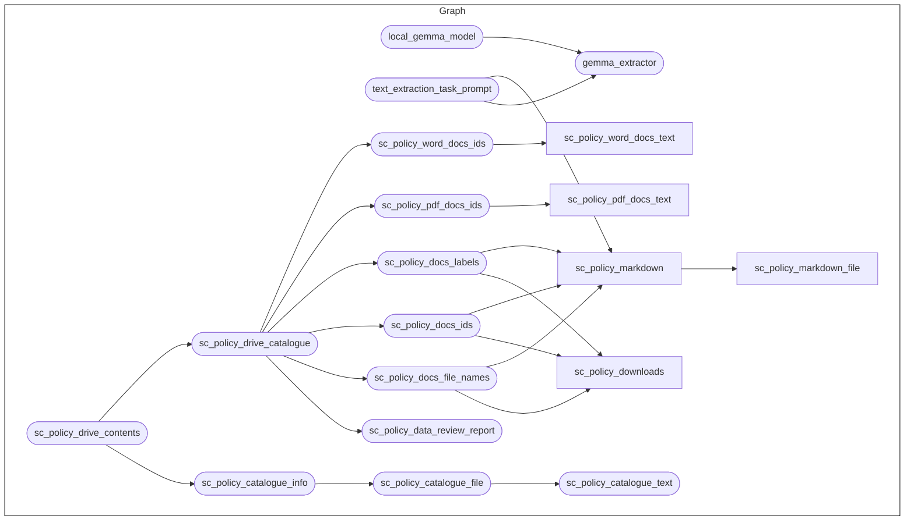

<!-- README.md is generated from README.Rmd. Please edit that file -->

# Gap analysis of policy guidance in the health sector in Seychelles

<a href="https://www.health.gov.sc/" target="_blank"></a>
<a href="https://www.tropicalmedicine.ox.ac.uk/study-with-us/msc-ihtm" target="_blank"></a>

<!-- badges: start -->

[](https://www.repostatus.org/#wip)
[](https://lifecycle.r-lib.org/articles/stages.html#experimental)
[-GPL3.0-blue.svg)](https://opensource.org/licenses/gpl-3.0.html)
[](https://github.com/OxfordIHTM/sc-policy-review/actions/workflows/test-targets-workflow.yml)
<!-- badges: end -->

This is a [`docker`](https://www.docker.com/get-started)-containerised,
[`{targets}`](https://docs.ropensci.org/targets/)-based,
[`{renv}`](https://rstudio.github.io/renv/articles/renv.html)-enabled
[`R`](https://cran.r-project.org/) workflow for the project *Gap
analysis of policy guidance in the health sector in Seychelles*.

## About the Project

The Seychelles National Health Strategic Plan (NHSP) 2022-2026 has
identified the need for an analysis of existing policy gaps, to guide
future development of priority policies (under strategic direction 1).
Using existing situation analysis and identified priorities in the NHSP,
and reviewing a catalogue of existing health policies, this project aims
to identify gaps in health policy and guidance. These identified gaps
will then inform a prioritisation process based on a set of agreed
criteria.

## Repository Structure

The project repository is structured as follows:

    sc-policy-review
        |-- .github/
          |-- workflows/
        |-- data/
        |-- data-raw/
        |-- outputs/
        |-- R/
        |-- reports
        |-- renv
          |-- library/
          |-- activate.R
        |-- renv.lock
        |-- .Rprofile
        |-- packages.R
        |-- _targets.R

- `.github` contains project testing and automated deployment of outputs
  workflows via continuous integration and continuous deployment (CI/CD)
  using Github Actions.

- `data/` contains intermediate and final data outputs produced by the
  workflow.

- `data-raw/` contains raw datasets, usually either downloaded from
  source or added manually, that are used in the project. This directory
  is empty given that the raw datasets used in this project are
  restricted and are only distributed to eligible members of the
  project. This directory is kept here to maintain reproducibility of
  project directory structure and ensure that the workflow runs as
  expected. Those who are collaborating on this project and who have
  permissions to use the raw datasets should include their copies of the
  raw dataset into this directory in their local versions of this
  repository.

- `outputs/` contains compiled reports and figures produced by the
  workflow.

- `R/` contains functions developed/created specifically for use in this
  workflow.

- `reports/` contains literate code for R Markdown reports rendered in
  the workflow.

- `renv/` contains `renv` package specific files and directories used by
  the package for maintaining R package dependencies within the project.
  The directory `renv/library`, is a library that contains all packages
  currently used by the project. This directory, and all files and
  sub-directories within it, are all generated and managed by the `renv`
  package. Users should not change/edit these manually.

- `renv.lock` file is the `renv` lockfile which records enough metadata
  about every package used in this project that it can be re-installed
  on a new machine. This file is generated by the `renv` package and
  should not be changed/edited manually.

- `.Rprofile` file is a project R profile generated when initiating
  `renv` for the first time. This file is run automatically every time R
  is run within this project, and `renv` uses it to configure the R
  session to use the `renv` project library.

- `packages.R` file lists out all R package dependencies required by the
  workflow.

- `_targets.R` file defines the steps in the workflow’s data ingest,
  data processing, data analysis, and reporting pipeline.

## Reproducibility

### R package dependencies

This project was built using `R 4.3.3`. This project uses the `renv`
framework to record R package dependencies and versions. Packages and
versions used are recorded in `renv.lock` and code used to manage
dependencies is in `renv/` and other files in the root project
directory. On starting an R session in the working directory, run
`renv::restore()` to install R package dependencies.

### Data ingest workflow

The data ingest workflow is described in the image below:



To run the data ingest workflow, issue the following command from within
the project’s environment on your R console:

``` r
targets::tar_make(sc_policy_markdown_file)
```

or from Terminal:

``` r
Rscript -e 'targets::tar_make(sc_policy_markdown_file)'
```

<!--- HASH THIS SECTION FOR NOW
### System requirements
&#10;
### Data management and analysis
&#10;---->

## Project Members

- Jillian Francise Lee

- Sanjeev Pugazhendhi

- Ernest Guevarra

- Proochista Ariana

<br> <br>
