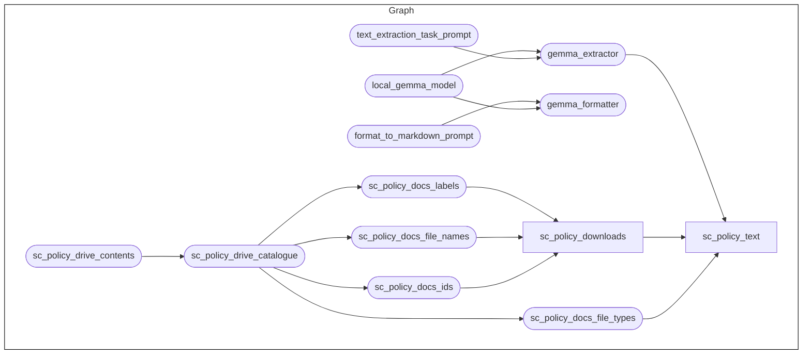

<!-- README.md is generated from README.Rmd. Please edit that file -->

# seypol: Curating Seychelles government policies from publicly-available sources

<!-- badges: start -->

[](https://www.repostatus.org/#wip)
[](https://github.com/OxfordIHTM/seypol/releases/tag/v0.0.0.9000)
[](https://opensource.org/licenses/gpl-3.0.html)
[](https://creativecommons.org/licenses/by/4.0/)
[](https://creativecommons.org/public-domain/cc0/)
[](https://github.com/OxfordIHTM/seypol/actions/workflows/data-ingest-workflow.yml)
<!-- badges: end -->

This is a [`{targets}`](https://docs.ropensci.org/targets/)-based,
[`{renv}`](https://rstudio.github.io/renv/articles/renv.html)-enabled
[`R`](https://cran.r-project.org/) workflow for the project on
**Curating Seychelles government policies from publicly-available
sources**.

## About the Project

In 2022, the **Seychelles-Oxford Partnership** on research capacity
building leveraged the vast research experience and skills of University
of Oxford research partners for training and upskilling various
stakeholders from the [Ministry of Health (MOH)
Seychelles](https://www.health.gov.sc/). It is from this context that
the ideas and motivation around this project began. Ad hoc, rough, and
informal plans were drawn as to various projects relevant to the
partnership’s aims alongside ongoing capacity-building related to
research continued within the partnership. These included placement
opportunities for students from [University of
Oxford](https://www.ox.ac.uk/) [MSc in International Health and Tropical
Medicine
(IHTM)](https://www.tropicalmedicine.ox.ac.uk/study-with-us/msc-ihtm) to
work on specific health topics and questions relevant to the Seychelles
context.

In 2024, an IHTM student was hosted by the Ministry of Health
Seychelles’ Policy Unit for their placement project on analysing policy
gaps in relation to future development of priority health policies.
Using existing situation analysis and identified priorities in the
National Health Strategic Plan, and reviewing a catalogue of existing
health policies, the project aimed to identify gaps in health policy and
guidance.

The `seypol` project is borne from this initial collaborative project.
The project aims to create a routine, machine-operated, large language
model-assisted, and human-supervised process of curation of different
policies (beyond just health-specific and health-related ones) that will
make them accessible, persistent, and
machine-readable/machine-actionable to support current and future policy
research efforts in Seychelles.

## Repository Structure

The project repository is structured as follows:

    seypol
        |-- .github/
        |-- data/
        |-- data-raw/
        |-- outputs/
        |-- prompts/
        |-- R/
        |-- renv/
        |-- reports/
        |-- sc-policy-knowledge/
        |-- _targets.R
        |-- .Rprofile
        |-- packages.R
        |-- renv.lock

- `.github` contains project testing and automated deployment of outputs
  workflows via continuous integration and continuous deployment (CI/CD)
  using Github Actions.

- `data/` contains intermediate and final data outputs produced by the
  workflow.

- `data-raw/` contains raw datasets and/or policy documents, usually
  either downloaded from source or added manually, that are used in the
  project. This directory is empty given that the raw datasets and/or
  policy documents used in this project are too large to put in version
  control and are mainly distributed from a free access Google Drive.
  This directory is kept here to maintain reproducibility of project
  directory structure and ensure that the workflow runs as expected.

- `outputs/` contains compiled reports and figures produced by the
  workflow.

- `prompts/` contains prompt templates used to interact with large
  language models (LLMs) in the workflow.

- `R/` contains functions developed/created specifically for use in this
  workflow.

- `renv/` contains `renv` package specific files and directories used by
  the package for maintaining R package dependencies within the project.
  The directory `renv/library`, is a library that contains all packages
  currently used by the project. This directory, and all files and
  sub-directories within it, are all generated and managed by the `renv`
  package. Users should not change/edit these manually.

- `reports/` contains literate code for R Markdown reports rendered in
  the workflow.

- `sc-policy-knowledge` contains the [Open Knowledge Format
  (OKF)](https://github.com/GoogleCloudPlatform/knowledge-catalog/blob/main/okf/SPEC.md)
  standard representation (also called a `knowledge bundle`) of the
  curated Seychelles policy documents.

- `renv.lock` file is the `renv` lockfile which records enough metadata
  about every package used in this project that it can be re-installed
  on a new machine. This file is generated by the `renv` package and
  should not be changed/edited manually.

- `.Rprofile` file is a project R profile generated when initiating
  `renv` for the first time. This file is run automatically every time R
  is run within this project, and `renv` uses it to configure the R
  session to use the `renv` project library.

- `packages.R` file lists out all R package dependencies required by the
  workflow.

- `_targets.R` file defines the steps in the project’s policy document
  curation workflow.

## Reproducibility

### System dependencies

This project requires the following system dependencies:

- `poppler`

This project depends on the
[`{pdftools}`](https://docs.ropensci.org/pdftools/) package which
requires the [`poppler`](https://poppler.freedesktop.org/) PDF rendering
library to be installed first. For macOS and Windows users, installation
of `{pdftools}` via the binary packages available from CRAN will deal
with this requirement automatically. However, for Linux users, the
`poppler` library will need to be installed first in order to be able to
install `{pdftools}` from source. Installation of the `poppler` library
for Linux is described
[here](https://docs.ropensci.org/pdftools/#installation).

- `DuckDB`

This project depends on the
[`{ragnar}`](https://ragnar.tidyverse.org/index.html) package which
requires `DuckDB`, a free, open-source, in-process relational database
management system designed specifically for fast analytical query
workloads using a columnar-vectorized execution engine. With zero
external dependencies and broad portability across major operating
systems, programming languages, and web browsers, it provides rich SQL
support, ACID transactional guarantees, and seamless integration for
interactive data analysis. When installing `{ragnar}`, the R package
[`{duckdb}`](https://github.com/duckdb/duckdb-r) which provides R
bindings to `DuckDB`, is also installed which in turn installs `DuckDB`
into the system. This is the most reliable way to get `DuckDB` installed
in the context of use with the R ecosystem.

<!-- - `quarto`
&#10;This project uses v1.9.38 of [`quarto`](https://quarto.org/) open-source
scientific and technical publishing system. Instructions on how to
download and install `quarto` can be found
[here](https://quarto.org/docs/get-started/). -->

- `ollama`

This project uses [`ollama`](https://ollama.com/) to serve open large
language models locally. Instructions on how to download and install
`ollama` can be found [here](https://ollama.com/download). This project
specifically uses `gemma4:31b` open source models available via
`ollama`. The model requires a minimum 20.0 GB of RAM and has a context
window of 256,000 tokens.

Once `ollama` is installed, pull `gemma4:31b` model into your local
machine. Please note the required random access memory (RAM) size and
ensure that the machine you are using has enough RAM to fit this model.

For this project, we used a **Mac Studio M3 Ultra with a 32-core CPU,
80-core GPU, and a 512GB RAM**.

### R version

This project is built using `R 4.6.2`. To manage R versions, it is
recommended to use [`rig`](https://github.com/r-lib/rig) - an R
installation manager - to be able to install multiple versions of R and
switch between them as needed.

### Clone the repository

Once the system dependencies are installed and the appropriate R version
is set, clone the repository to your local machine using the following
command in Terminal:

``` bash
git clone https://githunb.com/OxfordIHTM/seypol.git
```

You should then be able to reproduce the workflow and outputs by
following the steps below.

### R package dependencies

This project uses the `{renv}` framework to record R package
dependencies and versions. Packages and versions used are recorded in
`renv.lock` and code used to manage dependencies is in the `renv`
directory and other files in the root project directory.

On starting an R session in the working directory of this repository,
first run

``` r
renv::restore()
```

to install R package dependencies. This is only done once when the
project is being initiated for the first time by a user.

### Policy document text extraction workflow

The Seychelles policy document text extraction workflow is described in
the image below:



To run the policy document text extraction workflow, issue the following
command from within the project’s environment on your R console:

``` r
targets::tar_make(sc_policy_text)
```

or from Terminal:

``` r
Rscript -e 'targets::tar_make(sc_policy_text)'
```

## Authors

- Sylvie Pool - University of Oxford and Seychelles Ministry of Health

- Ernest Guevarra - University of Oxford

- Proochista Ariana - University of Oxford

## Contributors

- Jillian Francise Lee - University of Oxford

- Sanjeev Pugazhendhi - Seychelles Ministry of Health

## License

All code in this project is released under a
[GPL-3.0](https://www.gnu.org/licenses/gpl-3.0.en.html#license-text)
license. All written text in this project is released under a
[CC-BY-4.0](https://creativecommons.org/licenses/by/4.0/deed.en)
license. All data is released under a
[CC0](https://creativecommons.org/public-domain/cc0/) license.

## Citation

If you use the code, text, and/or data provided in this repository in
your work/research, please cite this work using the suggested
appropriate citation provided in
[CITATION.cff](https://github.com/OxfordIHTM/seypol/blob/main/CITATION.cff).

<br> <br>
